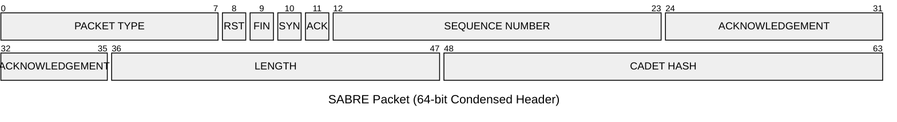

## 🎖️ Mission Briefing: Operation SABRE

**Situation**: Enemy forces are jamming all standard communication channels in the contested environment. TCP's complexity makes it vulnerable to detection and disruption. Command needs a lightweight, reliable data transfer protocol that can operate under heavy packet loss conditions.

**Mission**: You are a CY350-trained network communications expert tasked with implementing Simple And Basic Reliable Exchange protocol (SABRE), which is a custom Go-Back-N protocol over UDP. Your proof-of-concept sender must establish reliable communications with HQ's receiver, transfer critical intelligence, and extract the mission flag.

**Enemy Threat**: Expect approximately 20% packet loss on all transmissions. Your protocol must handle these losses gracefully through retransmissions and cumulative acknowledgements.

**Success Criteria**: Successfully complete the 3-way handshake, transfer the payload, and capture the flag from HQ's final FIN packet.

## 📋 Mission Objectives

In this project, you will implement a reliable data transfer protocol over UDP using the Go-Back-N protocol at the transport layer.

## 🤖 Generative AI Use Policy

### 📝 Report Portion - no generative AI assistance

The use of generative AI tools is __prohibited for the report portion__ of this assignment. Do not copy-paste any of the questions from gradescope into any generative AI tool.

### 👥 Programming Portion - Full Teaming, Cadet-Owned Work

The use of chat-based generative AI tools is _authorized_ for the programming portion of this assignment.

Generative AI may support the work throughout the process, including drafting, revising, coding, debugging, summarizing, analyzing, generating, or refining the submitted product. Cadets must validate generative AI contributions, acknowledge assistance, and remain responsible for the final submission.

> [!IMPORTANT]
> VS Code Copilot or any tools that directly modify your files cannot meet the DAAW requirement and must be disabled before you start writing any code for this project. [Features > Chat > Disable AI Features](vscode://settings/chat.disableAIFeatures)

_Failure to follow any of the above restrictions will be considered unauthorized collaboration and will result in a significant deduction of points._

### 🎓 Learning Objectives

- Explain why UDP is unreliable and describe strategies to achieve reliable data transfer over UDP.
- Design and implement a custom transport header with TCP-like flags and fields.
- Implement 3-way handshake over UDP and a graceful connection teardown.
- Implement sliding window protocols such as Go-Back-N.
    - Use a single base timer, cumulative ACKs, and bulk retransmissions.
- Analyze and understand protocol behavior using Wireshark.
- Reflect on trade-offs between protocol complexity and performance.

### 📤 Submission Instructions

1. You will submit your code to Gradescope. Autograder will tell you whether your program has the correct syntax, but will give you no feedback otherwise. You are responsible for testing your program and demonstrating that it works as expected.

1. Once you have a working implementation, you will answer several questions in another Gradescope assignment that explain your thought process. These must be answered in your own words without any assistance from generative AI tools. You may discuss these questions with your instructor and verbally assist others to develop understanding of the material, but you may not share your written responses with anyone else.

1. Shortly after you submit the project, you will take an in-class quiz that tests your knowledge and understanding of the solution.

### 🏅 Points Breakdown

- Python code quality: 5 points
- Server interaction: 25 points
- Report: 20 points
- In-Class Quiz: 20 points

### 🏆 Achievements - Server interaction

Track your mission accomplishments:

- 🟢 Radio Check - SYN packet sent successfully
- 🟢 Comm Link Established - Three-way handshake completed
- 🟢 First Transmission - First data packet acknowledged
- 🟢 Full Bandwidth - Window fully utilized (all slots in flight)
- 🟢 Retransmission Master - First timeout and retransmission handled
- 🟢 Payload Delivered - Full file transfer completed
- 🟢 Intel Recovered - Flag captured from FIN packet
- 🟢 Clean Extraction - Connection closed gracefully with FIN exchange

## 🎯 Protocol Specifications - SABRE

Tactical Overview: TCP is too complex and slow for our needs. We need something lightweight that can establish comms quickly, handle packet loss gracefully, and exfil before the enemy can triangulate our position.

You previously proposed Simple And Basic Reliable Exchange (SABRE) - a Go-Back-N protocol over UDP. USMA's CIO approved your design and wants a proof-of-concept implementation. Your sender will communicate with HQ's receiver running the same protocol on the WREN network.

Mission Objective: Implement Go-Back-N protocol for reliable data transfer over UDP to transfer a file from your sender to the HQ receiver. Once you successfully capture the flag from the server, your instructor will be automatically notified of your success.

### 📦 SABRE Protocol Packet Structure



### 🔧 Your Sabre Toolkit

Essential capabilities to implement:

- 🤝 Comm Link Establishment - 3-way handshake with SYN flag (like TCP, but over UDP)
- 🪟 Sliding Window - Manage flow of packets with configurable window size
- ⏱️ Single Timer - Track the oldest unacknowledged packet for timeout detection
- ✅ Cumulative ACKs - Acknowledge all packets up to a sequence number with one ACK
- 🔄 Bulk Retransmit - On timeout, resend ALL unacknowledged packets in the window (Go-Back-N style)
- 🛑 Clean Teardown - FIN sequence for graceful connection closure
- 🎯 Intel Extraction - Read the mission flag from the server's final FIN packet payload

### 🚀 Getting Started - Deploy your Sender

Acquire Assets: Grab the starter code from this repository using the green __Code__ button above.

Your Mission: Implement `sender.py` - this is your SABRE sender that will communicate with HQ's receiver on the WREN network.

Inspect Your Equipment: Review all artifacts in the bundle. Understand the function of each item.

Test Your Equipment: Run `uv run main.py --help` to see your command options and begin the mission.

Victory Condition: Successfully capture the flag from HQ's server. Your instructor will be automatically notified upon flag extraction!

### 📁 Project Files

- `main.py`: Main entry point for your sender. You will run this to start your sender and connect to the server.
- `sender.py`: This is where you will implement the SABRE protocol.
- `packet.py`: This file contains the `Packet` class that defines the structure of a SABRE packet and provides methods for serialization and deserialization.
- `simpletimer.py`: This file contains a simple timer class that you can use for implementing timeouts in your Go-Back-N protocol.
- `pyproject.toml`

### 🔑 Key Tasks

In `sender.py`, implement the following functions:

- `connect()`: Establish a connection with the server using a 3-way handshake.
- `send()`: Send data to the server using the Go-Back-N protocol.
- `close()`: Gracefully close the connection with the server using a FIN sequence.

Upon successful connection and data transfer, inspect the final FIN packet sent by the server.

### 💡 Intel & Tactical Tips

Reconnaissance:
- 🎓 Study the [Go-Back-N Protocol animation](https://media.pearsoncmg.com/ph/esm/ecs_kurose_compnetwork_8/cw/content/interactiveanimations/go-back-n-protocol/) from the textbook authors before engaging.

Debugging Your Equipment:
- 📡 Use print statements extensively to trace the flow of your program. The emojis in the starter code will help you track mission progress!
- ⏱️ You only need one timer for Go-Back-N (the `SimpleTimer` class is provided). Use it for the base of your window.

Protocol Reminders:
- 🔢 Sequence numbers start at 0 and increment by 1 for each packet sent (not bytes!)
- ✅ Outgoing ACKs from your sender will always be 0 (you don't receive data from HQ)
- ✅ Incoming ACKs from HQ tell you which packets have been successfully received

Monitor The Network: Use `tcpdump` to see what's happening on the wire. The enemy might be shooting down your packets!

### 🎯 Field Testing

Deploy To WREN: Run your sender on the WREN network. Expect to see server responses with approximately ~20% packet loss - this is the enemy jamming simulating real-world conditions!

Intel Gathering: Use `tcpdump` to capture all transmissions for post-mission analysis in Wireshark. Study the packet flow to understand how your protocol handles the contested environment.

```sh
sudo tcpdump -i lo --print -w sabre.pcap 'udp port 5050'
```

Success Condition: Once you see the flag in your final FIN packet response, you've successfully completed Operation SABRE! Your instructor will be notified automatically. Prepare and file a report with your findings.

## 📊 Explain your work

See the questions in the "report" assignment on Gradescope. You must answer these questions in your own words _without any Generative AI assistance_. You may discuss these questions with your instructor and verbally assist others to develop understanding of the material, but you may not share your written responses with anyone else.

> [!IMPORTANT]
> Submit annotated screenshots with your report on Gradescope. Screenshots without annotations will receive no credit.

> [!TIP]
> Use of generative AI is not necessary to complete this assignment. Several cadets have successfully completed this assignment in the past without using any AI-powered tools and truly enjoyed the experience.
